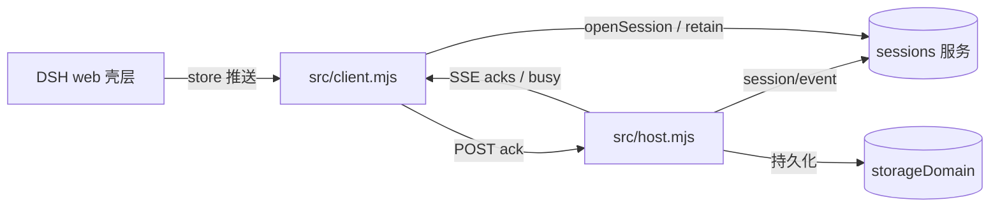

# 活动会话总览窗格架构

当前真相层：本文件描述插件与宿主 DSH 的现状。逐子系统实现细节见 `docs/design/`，宿主兼容承诺见 `docs/compatibility.md`。

## 系统上下文

- 插件由宿主侧与浏览器侧两半组成，同一 npm 包分发。
- 宿主侧是 cordis 插件，经注入的 `storageDomain`、`webServer`、`sessionQuery`、`connection` 工作：订阅 `session/event`、持久化 ack 与回合记账、提供 HTTP/SSE 通道。
- 浏览器侧在 DSH web 壳层内渲染：桌面为左栏右侧的常驻列，移动端（≤767px）为固定抽屉加头部开关。
- 浏览器侧只读消费壳层的 `sessions`、`workspaces`、`uiSession`、`jobs`、`uiWorkspace`、`remote.session` 客户端服务。
- 会话数据方向恒为「宿主/壳层推送 → 窗格卡片」；唯一写回路径是完成确认按钮，经宿主路由落地。
- 窗格不依赖第三方插件的数据路由，也不做状态轮询。
- 宿主可用服务缺失时各通道逐条降级，不阻断其余功能。

## 分层与依赖

| 模块 | 允许依赖 |
|---|---|
| `src/host.mjs` | `src/core.mjs` |
| `src/core.mjs` | 无 |
| `src/navigation.mjs` | 无 |
| `src/client.mjs` | 无 |

- 表只登记仓内模块依赖，外部包不占行。
- `src/host.mjs` 另引外部包 `@deepseek-ai/dsh-storage-domain` 与 `zod`；外部包不写入依赖表。
- `src/client.mjs`、`src/navigation.mjs`、`src/core.mjs` 无 ES import：三者由 `scripts/build-client.mjs` 拼接为单文件 bundle。
- 依赖方向单向：host → core；core 不得反向引用宿主或 DOM。
- 新增跨模块依赖必须先改本表，`node tools/xtask.mjs docs` 对照真实 import 校验该表。

## 组件分解

### host 服务端（`src/host.mjs`）

- 职责：回合结束登记、确认写回、回合时长记账、两条只读 SSE 通道、持久化落盘与卸载清理。
- 边界：不做呈现判定、不写会话日志、不轮询；主/子会话统一登记，过滤由客户端完成。
- 入口：`.dsh-plugin/index.mjs` 静态转发 `apply`/`inject`/`name`，实现只在本文件。

### core 纯逻辑（`src/core.mjs`）

- 职责：快照归一、显示过滤与排序、卡片签名、时间线折叠、模型/统计派生、档位谓词、记账纯函数。
- 边界：无 DOM、无服务句柄、无定时器；同一份代码被浏览器 bundle 与 Node 单测共用。
- 形态：全部函数与常量导出，输入非法时归一回退而不抛错。

### navigation 薄层（`src/navigation.mjs`）

- 职责：卡片点击/键盘激活绑定、在屏与抽屉收起判定、会话打开与重试、卡片滚动、遮罩收起、composer 自动聚焦抑制。
- 边界：只做小而可测的 DOM 封装与纯判定，不持有数据状态。

### client 渲染器（`src/client.mjs`）

- 职责：挂载与布局、数据订阅、卡片与时间线渲染、档位/密度、调宽、回前台自愈、卸载复位。
- 边界：唯一浏览器运行时；数据派生一律调用 core，不自建第二套判定。
- 结构：文件依次为常量、CSS、通道与订阅、渲染、交互、卸载。

### 支撑资产

- `scripts/` 承载构建、单测、门禁、性能与人工验收脚本。
- `e2e/` 承载真实浏览器隔离环境的端到端验证。
- `.dsh-plugin/` 承载发布入口与构建产物。

## 关键运行时流程

### 会话卡片渲染

- 壳层 store 推送 → 渲染合帧调度 → 派生（状态覆盖、当前会话、活动条目、历史候选）→ 渲染签名比对 → 复用 DOM 写入 → 整轮成功后提交签名。
- 正常分支：签名未变则整轮跳过 DOM 写入。
- 失败分支：任一步写入失败不提交签名，下一帧重试；列表 `pending/error` 显示加载态，不冒充空态。
- 合帧上限：连续事件按 250ms 窗口合并，空闲期无唤醒。

### 事件流订阅与断流恢复

- 可见且运行中的会话经 `sessions.retain(target, { source })` 持有代际引用 → `reference.ready` → 接 `binding.eventSource` 日志窗口与运行态订阅。
- 回前台恢复分三条独立通道：重建 acks/busy SSE；清掉在途渲染与派生 timer 后补一轮渲染；触屏形态且隐藏够久时请求壳层 `connection.reconnect()` 重建连接代际。
- 回合时长缺口经 `GET /busy?ids=` 触发宿主懒回填；回填以水位衔接，只增量应用未覆盖事件。
- 失败分支：`EventSource` 缺失静默降级；`connection` 缺失或重连抛错不阻断其余通道；回填失败 30s 退避后重试，不逐帧逼近轮询。

### 后台 jobs roster

- 列表快照变化 → 对列表全会话建立 `jobs.watchRows(id)` 引用计数共享流，离开列表即停流。
- 任务快照 `state.rows` 并入卡片派生：只标注在跑任务数量并产出任务子卡，不改变活动区归属与等待类别。
- 失败分支：`jobs` 服务缺失整轮跳过；单会话订流失败留待下一帧重试。

### 多客户端并发

- 多个客户端共享同一宿主进程的 domain 与 SSE 广播源；连接即收全量快照，此后只收增量补丁。
- 写回仅 ack：客户端先乐观更新，POST 失败则回滚本地游标并恢复提醒。
- 串行化：acks 读-改-写在单线程同步段闭合；busy 按会话串行域执行；事件序等于缓存变更序与广播序。
- 失败分支：落盘失败只告警不丢内存权威态，后续重标脏重写，缺口由全量重放自愈。

### 生命周期 retain/release

- 借用：retain 返回的引用只在已保留代际上借用会话面；代际终结后不再访问旧 binding。
- 释放点：可见性 prune、紧凑档拆窗、服务代际更替、插件卸载。
- 卸载顺序：断开全部 SSE → 取消订阅 → 释放 retain 引用 → 释放 HTTP 路由 → 冲刷脏键并关域（同一 disposer 内串行 await）。
- 热重载不变量：宿主在运行期可能 dispose 旧 fiber 并重新 apply（模块热重载，或 profile 重载重建该条目）；
  HTTP 路由注册经 `ctx.effect` 随 fiber 释放，重新 apply 必须能在同一 `webServer` 上再次挂载——
  旧路由滞留会让新实例以 `duplicate route` 启动失败，通道全部退化为 400，事件登记停摆
  （2026-11-27 本机事故，见 `docs/design/host-persistence.md`）。

## 数据与状态模型要点

- 卡片状态机：主会话取 `running`、`awaiting`（`waitClass` 为 `blocked`/`done`/`error`）；子代理仅在活动时出现；后台任务产出 `job` 子卡。
- 进入条件：自身运行中、存在阻塞等待、未确认完成（`lastTurnEnd > ackedAt`）、错误回合（`lastTurnEndKind === 'error'`）、存在活动后代。
- 解除条件：显式确认写回、新回合覆盖结束登记、后代耗尽后宽限期超时。
- 分区不变量：会话同一时刻要么在活动区、要么在历史区；历史区仅主会话，按最后活动时间倒序。
- 历史分页：首批 10 条，只由底部按钮显式追加，每批 10 条，不自动补页。
- 档位：`full`/`medium`/`compact` 三档，默认 `medium`，存 localStorage；档位是数据面与渲染面的唯一裁剪输入。
- 滚动锚：以当前会话卡片顶部相对滚动视口的位置为准；切档后在其沉降窗内逐帧补偿，超边界由浏览器钳制。
- 连接状态：壳层 gateway store、acks SSE、busy SSE 三条通道各自恢复；自建 SSE 无条件重建，壳层连接按形态与隐藏时长条件重建。
- 当前会话两维：`data-current` 表选中，`data-foreground` 表主区域在会话视图而非全局面板。
- 身份与颜色：`workspaceKey` 路径优先、名称兜底；每个身份独立哈希到固定前景/背景槽位，互不影响。

## 宿主边界

- 支持代际：0.2.0 与 0.2.2；版本矩阵见 `docs/compatibility.md`。
- 两代宿主的主要差异入口：会话面（retain/`subagentAddress`/`sessionStatus`/`jobs.watchRows`/`remote.session` 取代旧门面）、布局面（`main` 槽容器、entry 根、`layout.panelInfo`）、移动壳层（header 结构、hero 页、壳层开关语义属性、壳层 frame、标签行命中带）。
- 差异探测与补丁细节见 `docs/design/host-compat.md`。
- 版本矩阵、已验证宿主与残余边界见 `docs/compatibility.md`。

## 设计文档索引

| 主题 | 文件 |
|---|---|
| 两代宿主差异与补丁 | `docs/design/host-compat.md` |
| 断流恢复与懒回填 | `docs/design/resume.md` |
| 档位、密度与几何 | `docs/design/density.md` |
| 后台任务 roster 订阅 | `docs/design/jobs-roster.md` |
| client bundle 生成与字节一致性 | `docs/design/client-bundle.md` |
| ack/回合统计通道与持久化 | `docs/design/host-persistence.md` |
